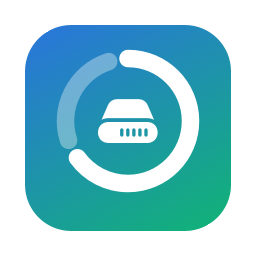
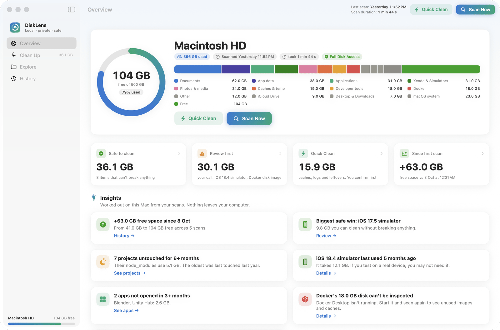
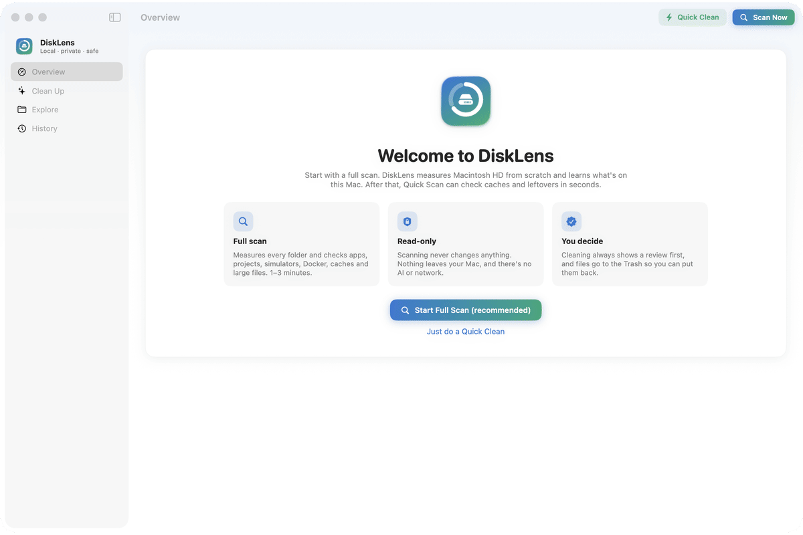
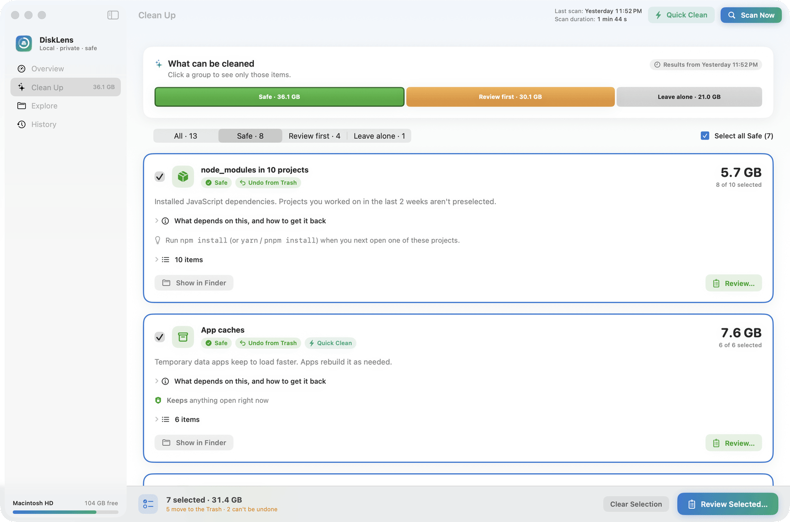
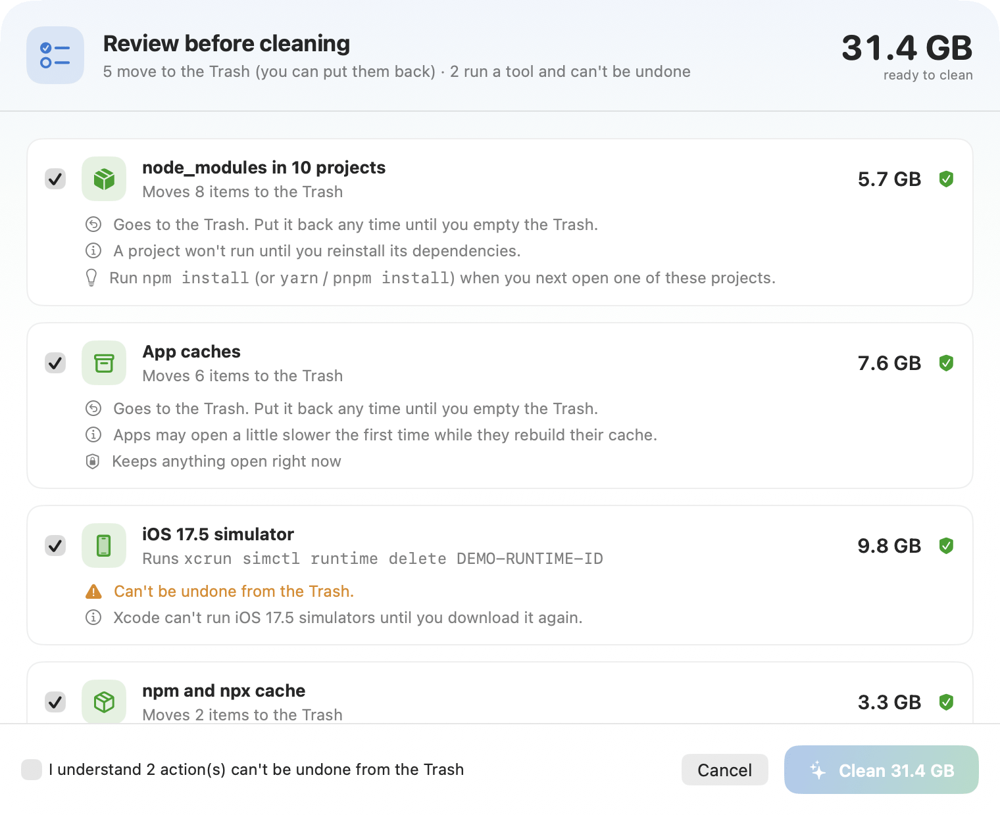
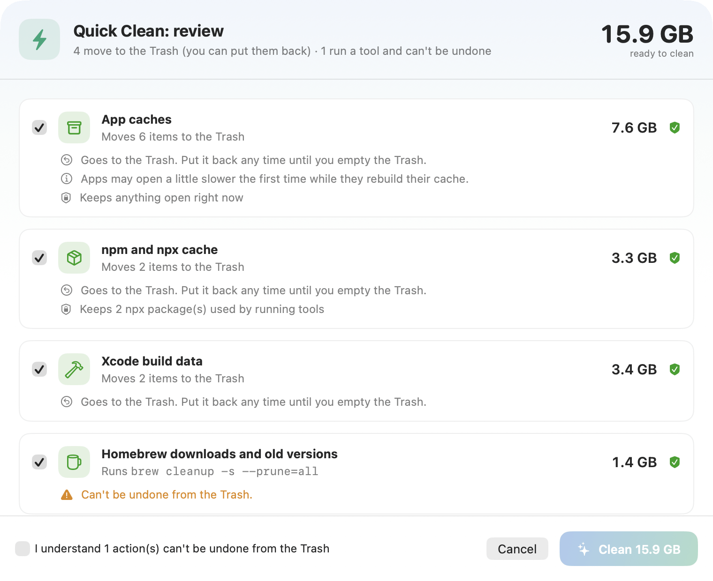
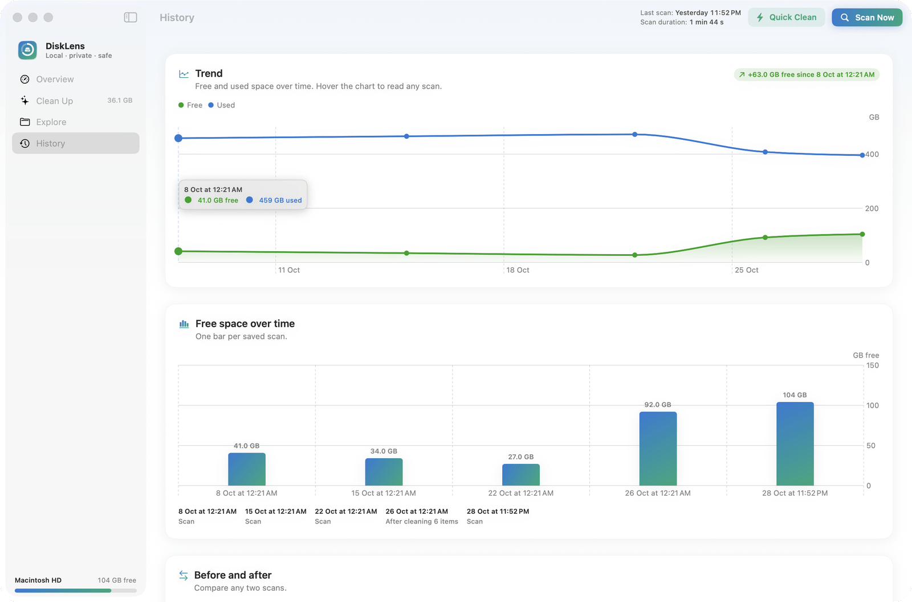
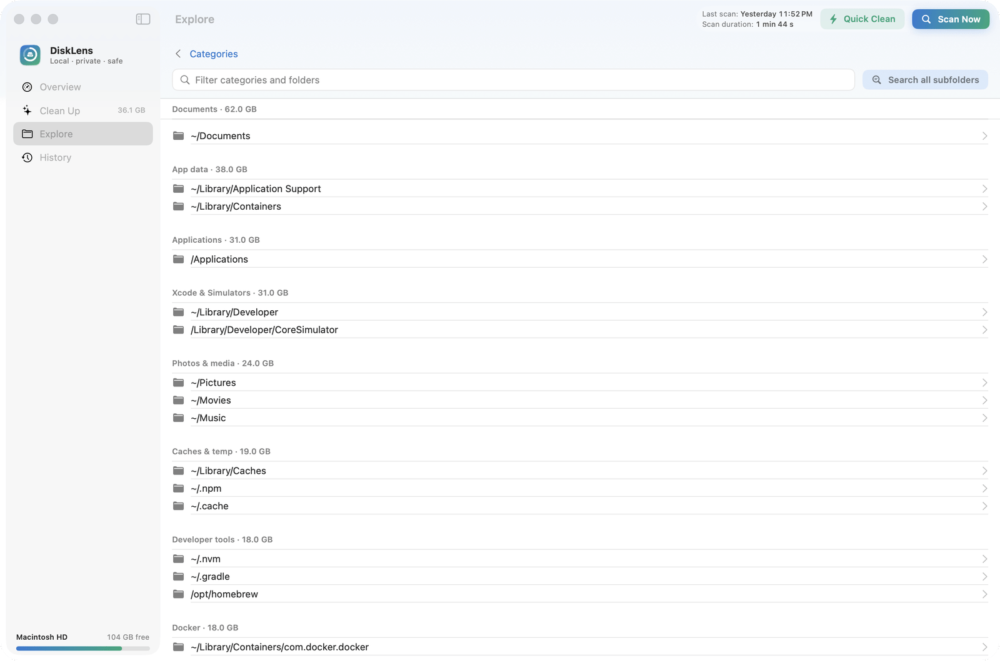
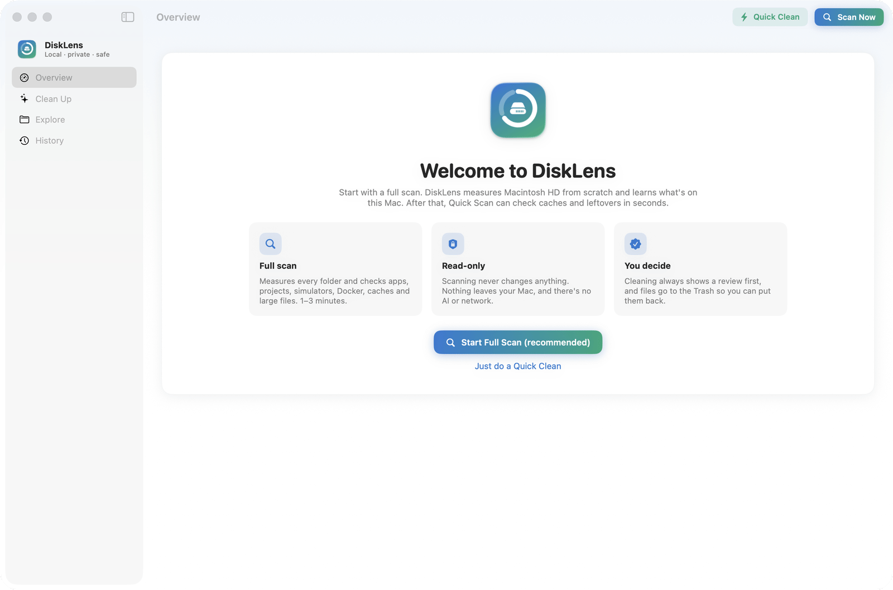

<p align="center">
  
</p>

<h1 align="center">DiskLens</h1>

<p align="center">
  <b>A free, open-source disk space analyzer and cleaner for macOS that explains before it cleans.</b><br>
  See what's filling your Mac, what depends on each item, and free up space safely: caches, Xcode simulators, Docker, node_modules, old SDKs and large files.<br>
  100% local · no AI · no network · no accounts.
</p>

<p align="center">
  <a href="https://github.com/mohitkale/disklens/actions/workflows/ci.yml"></a>
  
  
  
  <a href="LICENSE"></a>
  <a href="https://github.com/mohitkale/disklens/releases/latest"></a>
</p>

<p align="center">
  <a href="https://github.com/mohitkale/disklens/releases/latest"><b>⬇ Download the latest version</b></a> · <a href="#install">Install options</a> · <a href="#safety-model">How it stays safe</a>
</p>

<p align="center">
  
</p>

## Why DiskLens?

"System Data is 200 GB" doesn't tell you what to delete. Most cleaners either show a treemap and leave the decision to you, or delete things behind a single button. DiskLens does neither:

- **It explains every item.** It shows when the item was last used, which app or project uses it, how to get it back, and whether you can undo removing it. For example: *"iOS 17.5 simulator · last used 8 months ago · 2 simulators on it · Xcode last opened 2 days ago"*.
- **It sorts findings into Safe, Review first and Leave alone,** so you always know what can't break anything.
- **It never deletes directly.** Files move to the **Trash** (you empty it), and tool-owned data is cleaned with the tool's own command (`xcrun simctl`, `docker prune`, `brew cleanup`).
- **It checks before every cleanup,** right before acting, that the owning app isn't running and no process has the files open. Versions your projects pin (Android NDK and build-tools, for example) are kept.
- **It's built for developers' Macs,** but works on any Mac.

## Features

| | |
|---|---|
| **Full scan** | Measures the whole drive from scratch: categories, hidden space, macOS system, free space (1–3 min, read-only). |
| **Quick Scan + Quick Clean** | A ~15 s check of caches, logs and leftovers that nothing depends on. It shows a review and waits for your confirmation. |
| **Clean Up** | Filter by Safe / Review first / Leave alone, use **Select all**, open each item's details (*what depends on this*), then **Review Selected…** → **Clean**. |
| **Insights** | Free-space trend and forecast, biggest safe win, projects untouched for 6+ months, simulators last used months ago, apps you haven't opened, space hidden by macOS privacy. |
| **Explore** | Browse any folder by size, filter by name, or search every subfolder with Spotlight. Show in Finder or copy the path. |
| **History** | An interactive free/used trend chart, free space per scan, a before/after comparison of any two scans, and a cleanup log. |

### Take the tour

<p align="center">
  
</p>

### Screenshots

<table>
  <tr>
    <td width="50%"><b>Clean Up</b>: filter by group, select all, open the details of any item<br></td>
    <td width="50%"><b>Review before cleaning</b>: every item is re-checked, and risks are spelled out<br></td>
  </tr>
  <tr>
    <td><b>Quick Clean</b>: caches, logs and leftovers that nothing depends on<br></td>
    <td><b>History</b>: free and used space over time, with a reading for any scan<br></td>
  </tr>
  <tr>
    <td><b>Explore</b>: browse any folder by size, or search all subfolders<br></td>
    <td><b>First run</b>: a full scan is recommended before anything else<br></td>
  </tr>
</table>

### What it understands

Each rule only appears if that tool or app exists on your Mac:

- **Xcode:** simulator runtimes (with last-used dates and the simulators on each), orphaned simulators, simulator app data, DerivedData, device support, archives
- **Docker:** build cache, unused images, stopped containers and volumes, each labelled with its Compose project
- **JavaScript:** `node_modules` across all your projects (with framework, package manager and last-touched date), npm/npx/Yarn/Bun/pnpm caches
- **Other toolchains:** Gradle, Android SDK (NDKs, build-tools and system images your projects don't use), Cargo, Go, conda, Maven, NuGet, Dart/Flutter, CocoaPods, SwiftPM, Homebrew
- **Editors:** old version caches for VS Code, Cursor, Windsurf, VSCodium and other VS Code-based editors
- **macOS:** app caches (owner app and when you last opened it), logs, temp files, Mail attachment downloads, iPhone/iPad backups and firmware, macOS installers, apps not opened in 3+ months, large files over 1 GB, Downloads (with the site each file came from)
- **Leave alone, with reasons:** Photos and Music libraries, Mail, Messages, iCloud Drive, virtual machines, app-managed databases

## Install

DiskLens needs **macOS 14 (Sonoma) or later** and runs natively on Apple Silicon and Intel.

### Option 1: Download (recommended)

1. Download **`DiskLens-<version>-macOS.zip`** from the [latest release](https://github.com/mohitkale/disklens/releases/latest) (also under **Releases** on the right of this page).
2. Unzip it and drag **DiskLens.app** into your **Applications** folder.
3. Open it. The first time, macOS asks you to confirm because the app isn't notarized yet:
   - **macOS 15 and later:** open DiskLens once and dismiss the warning, then go to **System Settings → Privacy & Security** and click **Open Anyway** next to DiskLens.
   - **macOS 14:** right-click DiskLens.app → **Open** → **Open**.
   - Or, in Terminal: `xattr -dr com.apple.quarantine /Applications/DiskLens.app`

### Option 2: One command from source

```bash
git clone https://github.com/mohitkale/disklens.git && cd disklens && ./install.sh
```

`install.sh` checks your macOS version, installs Apple's Command Line Tools if Swift is missing, builds the app, copies it into `/Applications` (or `~/Applications`), and opens it. Run it again any time to update; the previous copy goes to the Trash. Add `--universal` to build for both Apple Silicon and Intel.

### Option 3: Build it yourself

```bash
scripts/build-app.sh            # universal DiskLens.app in build/
open build/DiskLens.app
```

`build-app.sh` signs with your Apple Development certificate if you have one, otherwise ad-hoc.

**Optional:** grant **Full Disk Access** (System Settings → Privacy & Security → Full Disk Access → add DiskLens) so it can also measure the Trash, Mail and iPhone backups.

**Command line** (read-only, saves nothing):

```bash
swift run DiskLens --scan            # human-readable report
swift run DiskLens --scan --json     # machine-readable
swift run DiskLens --scan --quick    # what Quick Clean would find
```

## Safety model

1. **Scanning is read-only.** DiskLens never scans or cleans on its own.
2. **Every cleanup goes through a review.** It re-checks each item, says what will happen and what could go wrong, and leaves out anything blocked (for example "Quit Cursor first"). You must tick *I understand* for anything the Trash can't undo, or anything marked *Review first*.
3. **Files only ever move to the Trash** (`FileManager.trashItem`). DiskLens never empties it.
4. **Tool-owned data is cleaned by the tool:** `xcrun simctl`, `docker … prune`, `brew cleanup`, `go clean`, `pnpm store prune`, `conda clean`.
5. **There are hard path guards.** DiskLens only touches items inside your home folder below its top-level folders, or a single non-App Store app bundle in Applications that isn't running. Keychains, `~/.ssh`, `~/Documents` itself and the system are never touched (see `Executor.isSafeToTrash` and its tests).
6. **Everything stays local.** Facts come from Spotlight metadata, app bundles, project files and each tool's own output. There are no network calls, analytics or AI.

## Development

```bash
swift build && swift test
DISKLENS_LIVE_TEST=1 swift test --filter Live   # moves two throwaway folders to your Trash
scripts/screenshots.sh                          # regenerates screenshots, tour GIF and social preview from sample data (needs ffmpeg)
```

| Path | What |
|---|---|
| `Sources/DiskLensCore/` | Models, history store, version logic (platform-neutral) |
| `Sources/DiskLensCore/Mac/` | Scanner, home-folder index, app index, disk measurement, executor |
| `Sources/DiskLensCore/Mac/Rules/` | Cleanup rules: Xcode, caches, projects, apps, package managers |
| `Sources/DiskLensApp/` | SwiftUI app (`DemoData.swift` powers the screenshots) |

Scan history is stored locally in `~/Library/Application Support/DiskLens/`.

Contributions are welcome, especially new cleanup rules. See [CONTRIBUTING.md](CONTRIBUTING.md).

## Roadmap

- Notarized releases (no first-launch warning)
- An iPhone companion that shows your Mac's scans via iCloud (iOS can't inspect its own storage)
- Scheduled reminders when free space runs low

## License

[MIT](LICENSE) © 2026 Mohit Kale
